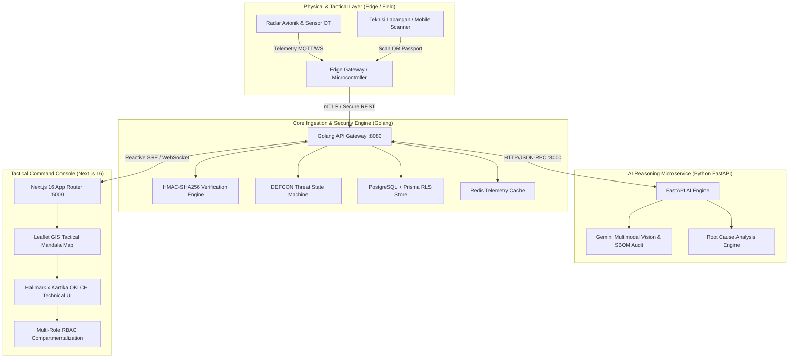

<div align="center">

# OZIK-SENTINEL
### Zero-Trust Military Alutsista Supply-Chain Gatekeeper, Physical-to-Cyber SIEM & Automated AI Forensics
**Pusat Sandi dan Siber TNI Angkatan Darat (PUSSIBERAD) — Core Cyber Defense Infrastructure**

[](https://go.dev/)
[](https://nextjs.org/)
[](https://react.dev/)
[](https://tailwindcss.com/)
[](https://www.postgresql.org/)
[](https://datatracker.ietf.org/doc/html/rfc2104)
[](https://tniad.mil.id/)
[](https://oziksentinel.biz.id)

---

</div>

## 1. Executive Summary & Tactical Overview

Modern military defense equipment (*alutsista*)—including tactical mobile radars, Software-Defined Radios (SDR), automated fire control systems, and base ammunition monitoring arrays—operate at the convergence of **Operational Technology (OT)** and **Information Technology (IT)**. 

Traditional Security Information and Event Management (SIEM) systems operate exclusively in the cyber domain. They are inherently blind to physical supply-chain breaches, rogue firmware flashes during depot servicing, or counterfeit field components introduced prior to deployment.

**OZIK-SENTINEL** resolves this critical vulnerability by establishing an unbreakable, cryptographically verifiable chain of custody spanning from procurement inspection to battlefield telemetry and post-incident legal forensics:

```
┌─────────────────────────┐     ┌─────────────────────────┐     ┌─────────────────────────┐
│         FASE I          │     │         FASE II         │     │        FASE III         │
│  Supply-Chain Gatekeeper│ ──> │ Physical-to-Cyber SIEM  │ ──> │ AI Digital Forensics &  │
│  & Cryptographic QR Seal│     │ & Service Window Lock   │     │ BAIFS Legal Evidence    │
└─────────────────────────┘     └─────────────────────────┘     └─────────────────────────┘
         RFC-2104                        Zero-Window                     SHA-256 Block
      HMAC-SHA256 Seal                 Telemetry Lock                    Immutable Ledger
```

---

## 2. Three-Phase Defense Doctrine

### Phase I · Supply-Chain Gatekeeper & Physical QR Passport
- **Multimodal AI Intake Audit:** Ingests procurement contracts, technical manifests, and vendor Software Bill of Materials (SPDX 2.3 ISO/IEC 5962 & OWASP CycloneDX JSON).
- **Automated CVE Risk Scoring:** Cross-examines SBOM packages against the National Vulnerability Database (NVD) to calculate exposure scores prior to network commissioning.
- **Physical QR Passport Issuance:** Generates a Mil-Spec 810H tamper-evident physical QR seal signed with **RFC-2104 HMAC-SHA256**. Any altered payload or unauthorized field substitution is mathematically rejected.

### Phase II · Physical-to-Cyber SIEM & Zero-Window Maintenance Lock
- **Physical-Cyber Context Binding:** Field engineers must scan the asset's cryptographic QR passport to open an authorized **Maintenance Service Window** before performing physical or firmware updates.
- **Micro-Audit Anomaly Detection:** Real-time OT sensor telemetries (firmware hash, bus voltage, operating temperature, ambient magnetic pulse) are correlated with network telemetry.
- **Zero-Window Enforcement:** Any firmware mutation or configuration change detected outside an authorized maintenance window is instantly classified as a high-priority cyber-physical breach, automatically escalating the **DEFCON Threat Level**.

### Phase III · Automated AI Forensics, Micro-Airgap Kill-Switch & Legal Chain
- **AI Root Cause Analysis (RCA):** Multimodal inference reconstructs the attack kill-chain from edge logs, identifying patient zero, attack vectors, and operational impact within seconds.
- **Instant Tactical Kill-Switch:** Authorized commanders can instantaneously isolate compromised nodes across tactical subnets (*Micro-Airgap Isolation*), preventing lateral movement.
- **Immutable SHA-256 Ledger & BAIFS:** The entire incident trajectory is sealed into a tamper-proof cryptographic hash chain, outputting official military forensic dossiers (*Berita Acara Investigasi Forensik Siber / BAIFS*) admissible in military tribunals.

---

## 3. High-Level System Architecture



---

## 4. Role-Based Access Control (RBAC) & Military Compartmentalization

Security is enforced via a strict military compartmentation doctrine. Users switch simulated operational roles without changing their authenticated email identity, with all actions permanently logged under their respective role's cryptographic ledger:

| Tactical Role | Code Identifier | Primary Operational Responsibilities | Clearances & Authorities |
| :--- | :--- | :--- | :--- |
| **Panglima Siber** | `SUPER_ADMIN` | Full sovereignty over command infrastructure, personnel approvals, and system-wide audit. | Full cross-compartment authority, user provisioning, global RBAC overrides. |
| **Komandan Satuan** | `COMMANDER` | Tactical defense command, DEFCON threat monitoring, and emergency response. | Command Center GIS, SIEM supervision, **Tactical Kill-Switch execution**. |
| **Perwira Logistik** | `LOGISTICS_OFFICER` | Supply-chain intake, vendor SBOM inspection, and equipment QR passport issuance. | Gatekeeper intake, vulnerability CVE scans, Mil-Spec QR seal publishing. |
| **Auditor Forensik** | `FORENSIC_AUDITOR` | Physical-to-cyber anomaly investigation, cryptographic verification, and legal reporting. | AI Root Cause Analysis (RCA), SHA-256 hash-chain audit, **BAIFS dossier export**. |

---

## 5. Monorepo Repository Structure

```
ozikra/
├── fe/                            # Next.js 16 App Router Frontend Console
│   ├── public/                    # Iconic Kartika Eka Paksi SVG/PNG Favicons
│   ├── src/
│   │   ├── app/
│   │   │   ├── dashboard/         # Command Center, Gatekeeper, SIEM, Forensics, Assets, Ledger
│   │   │   ├── onboarding/        # Military Credential Activation & Super Admin queue
│   │   │   ├── verify/            # Public QR Passport HMAC verification portal
│   │   │   └── page.tsx           # Hallmark Editorial Hero & Doctrine Factsheet
│   │   ├── components/            # OKLCH-styled UI components, GIS Map, Shell, Header, Sidebar
│   │   └── lib/                   # RBAC matrix, Session context, Supabase & REST client
│   └── package.json               # Next.js 16, React 19, Tailwind v4
├── ozik-sentinel-backend/         # Core Golang Backend Engine
│   ├── cmd/
│   │   ├── iot_simulator/         # Interactive CLI Tactical IoT/OT simulator
│   │   └── server/                # Production backend entrypoint
│   ├── internal/
│   │   ├── handlers/              # Auth, QR verification, SIEM telemetries, Admin approvals
│   │   ├── models/                # Tactical asset, telemetry, and forensic data schemas
│   │   └── repository/            # PostgreSQL & in-memory zero-trust fallback persistence
│   ├── ai_service.py              # Python FastAPI AI microservice for RCA & SBOM reasoning
│   └── main.go                    # HTTP mux routing & CORS engine
├── ozik-iot-edge/                 # Hardware & Embedded IoT Firmware
│   └── simulator.go               # Physical sensor stream simulator (Temperature, Voltage, Vibration)
├── scripts/                       # Asset & cryptographic key generators
├── docker-compose.yml             # Orchestration for Frontend, Backend, AI service, and Database
├── start_all.bat                  # One-click Windows development launcher
└── run_hackathon.sh               # One-click Unix / macOS development launcher
```

---

## 6. Quickstart & Local Development

### Prerequisites
- **Go:** `1.22+`
- **Node.js:** `20.x` or `22.x` (`pnpm` or `npm`)
- **Python:** `3.10+` (for AI reasoning service)
- **Docker & Docker Compose:** *(Optional, for containerized run)*

### Option A: One-Click Development Launchers

**On Windows (PowerShell / Command Prompt):**
```cmd
start_all.bat
```

**On Linux / macOS:**
```bash
chmod +x run_hackathon.sh
./run_hackathon.sh
```

### Option B: Docker Compose (Full Stack)

```bash
docker compose up --build
```

### Option C: Manual Service-by-Service Startup

1. **Start Core Golang Backend (:8080):**
   ```bash
   cd ozik-sentinel-backend
   go run .
   ```

2. **Start AI Reasoning Engine (:8000):**
   ```bash
   cd ozik-sentinel-backend
   python -m uvicorn ai_service:app --host 127.0.0.1 --port 8000
   ```

3. **Start Next.js Tactical Console (:5000):**
   ```bash
   cd fe
   npm install
   npm run dev
   ```

4. **Launch Tactical IoT/OT Telemetry Simulator:**
   ```bash
   cd ozik-sentinel-backend
   go run ./cmd/iot_simulator --interactive
   ```

Access the operational console at: **`http://localhost:5000`**

---

## 7. Cryptographic Standards & Defense Specifications

- **RFC-2104 HMAC-SHA256:** High-entropy secret key binding asset serial, procurement batch, and hardware MAC address into a 32-byte cryptographic token embedded in the physical QR passport.
- **SHA-256 Merkle Hash-Chain:** Immutable audit ledger linking block index, epoch timestamp, actor NRP/identity, event signature, and parent block hash (`prev_hash`).
- **ISO/IEC 5962 & OWASP CycloneDX:** Standardized parsing engine verifying component licenses, dependencies, and SHA-1/SHA-256 binary package hashes.
- **STANAG NATO & TNI-AD Cyber Compatibility:** Calibrated for operational compliance with Indonesian Army Cyber Command (*Pusat Siber TNI Angkatan Darat*) doctrine.

---

## 8. Deployment & CI/CD

- **Production Console:** [https://oziksentinel.biz.id](https://oziksentinel.biz.id)
- **Zero-Trust Identity:** Integrated Google OAuth SSO with deterministic military NRP derivation and Super Admin approval dispatch queue.
- **Container Registry:** Standardized multi-stage Dockerfiles optimized for lightweight production footprints (`distroless/static` for Go, standalone Next.js server).

---

## 9. License & Attribution

Developed for the **Kartika Cyber Hackathon 2026** by the **OZIK-SENTINEL Development Team**.  
All rights reserved for the official defense infrastructure of the **Pusat Sandi dan Siber TNI Angkatan Darat (PUSSIBERAD)**.
